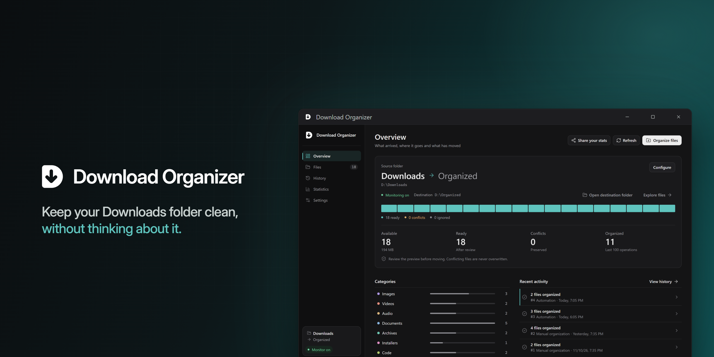

<p align="center">
  
</p>

<h1 align="center">Download Organizer</h1>

<p align="center">
  <strong>Keep your Downloads folder clean, without thinking about it.</strong>
</p>

<p align="center">
  <a href="https://github.com/thonyydev/DownloadOrganizer/actions/workflows/ci.yml"></a>
  <a href="https://github.com/thonyydev/DownloadOrganizer/releases"></a>
  
  
  <a href="LICENSE"></a>
</p>

<p align="center">
  <a href="https://github.com/thonyydev/DownloadOrganizer/releases"><strong>Download</strong></a> ·
  <a href="https://downloadorganizer.thonyy.dev">Website</a> ·
  <a href="https://github.com/thonyydev/DownloadOrganizer/issues">Report a bug</a>
</p>

---

Download Organizer is a free, open-source desktop app for Windows 11 that sorts your Downloads folder (and any other folder you choose) into tidy categories. You see every move before it happens, nothing is ever overwritten, and you can undo what you did. Everything runs on your computer: no account, no cloud, no telemetry.

## Features

**Organize**

- **Smart categories** — Images, videos, audio, documents, archives, installers and code, each in its own folder. Turn off any category you don't want sorted.
- **Custom rules** — Send files to your own folders by name or pattern, like `*.stl` or `invoice*.pdf`, or keep them where they are.
- **Multiple folders** — Organize Downloads, Desktop or any other folder, all into one destination.
- **Automatic organization** — Optionally sort new downloads as they arrive, from the system tray.

**Stay in control**

- **Preview first** — See exactly where each file will go, and pick which ones to move. Conflicts are listed first, and images, audio and video can be previewed without changing them.
- **Undo** — Put moved files back where they were, as long as they haven't changed since.
- **Activity history** — See what was organized and when.
- **No overwrites** — Name conflicts are detected, and existing files are never replaced.
- **Cloud-aware** — Online-only files, such as OneDrive files that aren't downloaded, stay where they are. The app never downloads them.

**Feels at home**

- **5 languages** — English, Portuguese, Spanish, French and Italian. The app and new category folders follow your Windows language, or the one you pick in Settings. Folders that already exist are not renamed or moved.
- **Dark and light themes** — Plus optional sound effects.
- **Private by design** — No account, no telemetry, no cloud uploads.

## How it works

1. **Choose your folders** — Pick the folder to organize, and add more if you like.
2. **Set your preferences** — Choose a destination and the categories or rules to use.
3. **Preview** — Review each file and where it will go.
4. **Organize** — Confirm, and Download Organizer handles the rest.

Prefer hands-off? Turn on automatic organization and new downloads are sorted while the app runs in the background.

## Default categories

| Folder | File types |
| --- | --- |
| Images | `jpg` `jpeg` `png` `gif` `webp` `svg` `bmp` `ico` `heic` `avif` `tiff` `tif` `raw` |
| Videos | `mp4` `mkv` `mov` `avi` `webm` `m4v` `mpg` `mpeg` `wmv` |
| Audio | `mp3` `wav` `flac` `aac` `ogg` `m4a` `opus` `aiff` |
| Documents | `pdf` `doc` `docx` `xls` `xlsx` `ppt` `pptx` `txt` `csv` `odt` `ods` `rtf` `epub` `md` |
| Archives | `zip` `rar` `7z` `tar` `gz` `bz2` `xz` `tgz` |
| Installers | `exe` `msi` `msix` `appx` `dmg` `pkg` `deb` `rpm` `appimage` |
| Code | `rs` `ts` `tsx` `js` `jsx` `py` `java` `c` `cpp` `h` `cs` `go` `html` `css` `json` `yaml` `yml` `toml` `sql` `sh` `ps1` `ipynb` |
| Other | Everything else, including files with no extension |

Folder names follow the app's language. [Custom rules](#features) are checked first: the first rule that matches a file decides where it goes, even if that file's category is turned off.

## Installation

1. Download the latest `-setup.exe` installer from the [Releases page](https://github.com/thonyydev/DownloadOrganizer/releases).
2. *(Optional)* Check that the file is intact. Each release has a `.sha256` file next to the installer; compare its contents with:

   ```powershell
   Get-FileHash ".\Download.Organizer_<version>_x64-setup.exe" -Algorithm SHA256
   ```

3. Run the installer.

> [!NOTE]
> The installer isn't code-signed yet, so Windows SmartScreen may show a warning. Click **More info → Run anyway** to continue. Download Organizer is in beta and supports Windows 11.

### Updates

Updates come from this project's GitHub Releases and are verified against a signature before they're installed.

- **Window open:** the app asks before updating.
- **Running in the tray:** the app installs the update and reopens on its own.

Your settings and history are kept. To check right away, use **Check for updates** in Settings, where you can also turn automatic updates off.

### Uninstalling

Uninstall from **Windows Settings → Apps**. Your organized files are never touched. Settings and history stay in `%APPDATA%\com.thonyy.download-organizer` until you delete that folder.

## Good to know

**What gets organized**

- Only files at the top level of each source folder are moved. Subfolders are left alone.
- Temporary files, empty files and downloads still in progress are skipped. No check can catch every case, so use the preview if you're unsure.
- Files already in their category folder are left alone.
- If a source folder goes missing (an unplugged drive, for example), organizing pauses until you reconnect it or remove it in Settings.
- A destination on another drive works, but takes longer: each file is copied, verified, and only then removed from the source.

**Automatic organization**

- Off by default.
- Only handles new files, and waits until a file has gone 10 seconds without being written to.
- While it's on, closing the window keeps the app running in the system tray. Choose **Quit** from the tray icon to stop it.
- Notifications cover automatic organization and monitoring problems. You can turn them off in Settings, and you can also have the app start with Windows (off by default).

**Conflicts and undo**

- A file is never overwritten. In the preview, you can choose to rename it instead, like `file (2).pdf`. Automatic organization leaves conflicting files where they are.
- Undo restores a file only if it hasn't changed since it was moved.

## Privacy

Download Organizer has no account, no telemetry and no cloud service.

- **Network:** its only network use is checking GitHub for updates at startup, every 6 hours, and when you check manually. This shares your IP address with GitHub and sends no file data. Turning off automatic updates stops the automatic checks.
- **Local data:** a local database stores file paths, sizes, dates and content hashes, so the app can show your history and undo safely. It never leaves your computer.

When reporting a problem, please remove personal file names and paths, and don't attach the database.

## Built with

[Tauri 2](https://v2.tauri.app) · [Rust](https://www.rust-lang.org) · [React](https://react.dev) · [TypeScript](https://www.typescriptlang.org) · [Tailwind CSS](https://tailwindcss.com)

All file access and validation happen in Rust. The React interface only shows state and asks for actions.

## Building from source

The app builds only on Windows. You'll need [Node.js](https://nodejs.org), [Rust](https://rustup.rs) and the [Tauri prerequisites for Windows](https://v2.tauri.app/start/prerequisites/).

```powershell
# Install dependencies
npm ci

# Run in development mode
npm run tauri dev

# Run the tests
npm test

# Build the installer (output in src-tauri/target/release/bundle/nsis/)
npm run tauri build
```

> [!WARNING]
> A development build shares settings and history with an installed copy. Quit the installed app from the tray first, and never test with your real Downloads, Desktop or OneDrive folders. Use temporary folders with copies of files.

## Contributing

Ideas, bug reports and feedback are always welcome — [open an issue](https://github.com/thonyydev/DownloadOrganizer/issues). To contribute code or translations, see [CONTRIBUTING.md](CONTRIBUTING.md). Each translation lives in a single file in [`i18n/`](i18n).

See what changed in each version in the [CHANGELOG](CHANGELOG.md).

## License

[MIT](LICENSE). The Download Organizer name and logo aren't covered by this license. Third-party notices are in [`public/`](public).

---

<p align="center">
  Made with care by <a href="https://github.com/thonyydev">Thonyy</a>
</p>